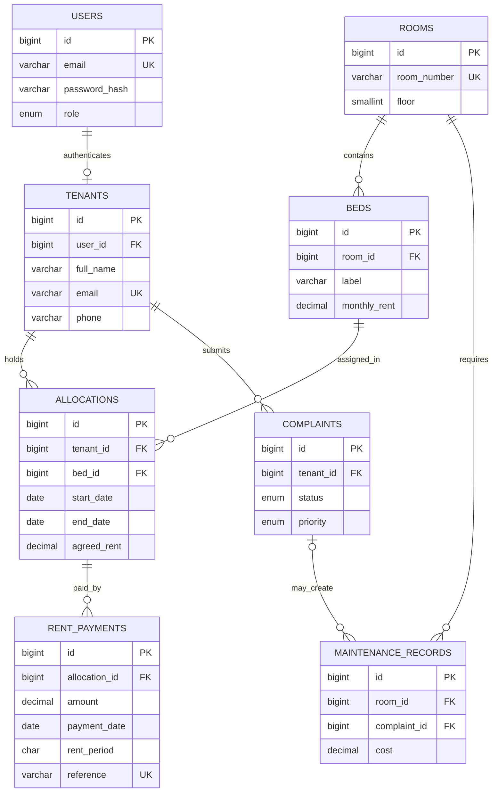

# ER diagram and relational design

A user has zero or one tenant profile; administrators have no tenant row. Rooms can have zero or more beds. Tenants and beds can have many historical allocations, while a tenant and bed each have at most one active allocation. Payments belong to allocations, complaints belong to tenants, and maintenance records belong to a room and may reference a complaint.

## Normalization and functional dependencies

All stored values are atomic (1NF). Every table uses a single-column surrogate primary key, so non-key attributes depend on the whole key (2NF). Attributes are kept with the entity they describe; there are no non-key-to-non-key dependencies within a relation (3NF). Principal dependencies:

- `users.id → email, password_hash, role`
- `tenants.id → user_id, full_name, email, phone, is_active`
- `rooms.id → room_number, floor, is_active`
- `beds.id → room_id, label, monthly_rent, is_active`
- `allocations.id → tenant_id, bed_id, start_date, end_date, agreed_rent`
- `rent_payments.id → allocation_id, amount, payment_date, method, reference, rent_period`
- `complaints.id → tenant_id, category, description, priority, status, resolution_notes, dates`
- `maintenance_records.id → room_id, complaint_id, description, cost, dates`

`users.email` is the sign-in address; `tenants.email` is the resident contact address. They are separate attributes because account access and contact details are different concerns, even when the initial value is the same.

MySQL has no general partial unique index. Generated nullable columns on allocations contain the tenant/bed ID only while `end_date IS NULL`. Unique indexes allow multiple historical NULL values and reject concurrent duplicate active tenant or bed assignments. Allocation APIs lock tenant and bed rows in a transaction; the unique indexes are the final integrity guard.
